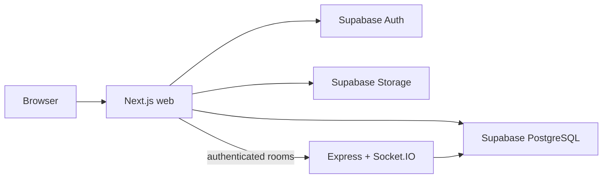

# RASMALAI — Product and phase plan

## Product scope

Rasmalai is a social board gaming platform. Phase 1 provides email account flows, profiles and security foundations. Phase 2 adds player search, friends, messaging, requests and notifications. Phase 3 adds offline local play for Ludo, Tic Tac Toe and Snakes & Ladders. Phase 4 adds authoritative online play for all three games, public and invite-only rooms, private player chat/reactions, opt-in WebRTC voice, results, statistics and history. Phase 5 adds public and invite-authorized spectator viewing, a separate spectator chat/reaction channel, presence and invitations. Live spectator, multi-account and microphone acceptance remains pending authorized multi-account/device testing.

The three supplied game images are visual references. The product uses the jungle greens, bright game colors, rounded tiles, and board-game geometry as inspiration. It does not reproduce their artwork or frame the product as a food brand.

## Proposed project structure

```text
apps/
  web/                         Next.js App Router, React, TypeScript, Tailwind
    app/                       Routes and server actions
    components/                Shared navigation, forms, artwork, cards
    lib/                       Supabase SSR, auth helpers, validation
  realtime/                    Express and Socket.IO service shell
    src/                       HTTP health route and socket bootstrap
  packages/
  game-engine/                 Pure game engines shared by offline UI and realtime service
  database/                    Prisma schema, config, generated client
    prisma/                    PostgreSQL schema and migrations
    src/                       Server-only Prisma client
docs/
  project-plan.md              Architecture, schema, env, phase checklist
```

## Frontend and backend architecture

- **Web:** Next.js App Router, React Server Components for protected pages and data reads, Client Components for form state and avatar upload, TypeScript, Tailwind CSS 4.
- **Authentication:** Supabase Auth owns credentials and sessions. Next.js uses `@supabase/ssr` cookie clients and a `proxy.ts` session refresh. All server authorization reads the verified user with `auth.getUser()`.
- **Profile data:** PostgreSQL on Supabase. Prisma is the server-only ORM. The authenticated Supabase UUID is the profile primary key; user contact details stay in Supabase Auth and are never copied into public profile data. Server actions verify the user before profile writes.
- **Social data:** User-scoped Prisma reads use a Supabase Auth-verified token and transaction-local `authenticated` identity. RLS limits reads to public profiles, request participants, conversation members, and notification recipients. Social mutations use security-definer functions that derive the actor from `auth.uid()`; authenticated users have no direct social table write grants.
- **Images:** Supabase Storage bucket `profile-avatars`; objects live under the authenticated user's UUID. Public reads are limited to profile pictures; writes and deletes are restricted by Storage RLS to the owner's folder.
- **Realtime service (Phase 4):** Separate Node.js/Express/Socket.IO app. It verifies Supabase sessions and player roster membership, applies shared game engines server-side, generates dice values on the server, and writes versioned game state through narrow database RPCs. Players resume a room after reconnect; match completion updates results and profile statistics.
- **Game engines:** Pure TypeScript transitions live in `packages/game-engine`, re-exported to preserve offline UI imports. Offline game routes keep in-memory state and work without Supabase. Online requests call the same rules through the authoritative realtime service.
- **Match communication (Phase 4):** Socket.IO carries authenticated player chat, emoji reactions and WebRTC signaling. Player chat/history and voice signaling are player-only. Voice is peer-to-peer for up to four Ludo players and two Tic Tac Toe players (Snakes & Ladders allows two to four). It requests microphone permission only after the explicit Join control, begins muted, exposes mute/unmute/leave controls, stops tracks on leave, and never records audio. Reconnection never enables the mic.
- **Spectating (Phase 5):** Eligible signed-in users can watch active public matches; private rooms require an unexpired, accepted spectator invitation. A separate `spectator:${roomId}` Socket.IO channel carries read-only board snapshots, player presence/reactions, and spectator text/reactions. It never carries player chat or voice. Snapshot access, invitation lifecycle, presence, and spectator chat use guarded database RPCs and active-roster RLS checks. Spectator actions are rejected by role authorization and never reach the game engine.
- **Voice hosting and cost gate:** WebRTC with STUN can establish direct connections without a media relay, but NAT/firewall conditions may require TURN. TURN relays media and can create server, bandwidth, and egress costs whether self-hosted or managed. Use free/local options for development, measure connectivity and expected concurrent usage, and document current provider/hosting estimates before introducing any paid TURN or hosting service. Do not promise production voice connectivity using STUN alone.
- **Deployment:** `apps/web` is suitable for Vercel; `apps/realtime` is a long-lived Node service for Render or another WebSocket-capable host. PostgreSQL, Auth, and Storage are hosted by Supabase.



The database is accessed only from trusted server code with server-side credentials. Never expose `DATABASE_URL`, `DIRECT_URL`, or any Supabase secret key to browser bundles. Route handlers and server actions are treated as public HTTP endpoints and perform their own authentication and validation.

## Relational schema

Supabase owns `auth.users`; the app does not duplicate email addresses or phone numbers. `profiles.id` is the corresponding Auth UUID, without a cross-schema foreign key. The app schema is kept in `packages/database/prisma/schema.prisma`.

| Table | Purpose and important relationships |
| --- | --- |
| `profiles` | Public gaming identity, unique username, nickname, avatar URL, joined date, aggregate stats. Primary key matches the Supabase Auth UUID. |
| `friendships` | Accepted pair of profiles; canonical ordered pair and unique constraint prevent duplicate relationships. |
| `friend_requests` | Sender, recipient, status and timestamps; unique pending direction and indexes for inbox/outbox. |
| `user_blocks` | Blocker and blocked profile; unique pair; prevents friend and message interactions. |
| `conversations` | Private conversation container and creation time. |
| `conversation_members` | Profile membership and read cursor; unique conversation/profile pair. |
| `message_requests` | Non-friend request, status, sender and recipient; acceptance can create a conversation. |
| `messages` | Conversation messages with author, body, timestamp, edit/delete metadata and unread indexes. |
| `game_chat_messages` | Match-scoped text for authorized players, with room, author, content, and creation time; never exposed through broad public or friend policies. |
| `game_chat_reactions` | Emoji reactions linked to a match chat message and authenticated reactor; an allowlist and match membership are enforced. |
| `game_rooms` | Room code, game type, privacy, creator, selected seats, status and lifecycle timestamps. |
| `room_players` | Human player seats; unique room/profile and room/seat constraints. No bot identity is modeled. |
| `spectators` | Read-only room membership and presence; unique room/profile pair, last-seen/disconnect/leave timestamps. |
| `spectator_invites` | Private-room spectator authorization, recipient, expiry, and pending/accepted/canceled status. |
| `spectator_chat_messages` | Text messages in the separate spectator channel, readable only by active spectators and room players through guarded paths. |
| `spectator_chat_reactions` | Emoji reactions scoped to spectator messages and authorized room membership. |
| `game_states` | One authoritative JSON state per room with version for optimistic/duplicate-move protection. |
| `game_moves` | Ordered, validated match actions with actor, action payload and idempotency key. |
| `matches` | Completed/active match record, room, game type, winner, start/end times and final state. |
| `match_players` | Match participants, seat, result and per-match stats. |
| `game_invites` | Inviter, invitee, room, status and expiration. |
| `notifications` | Recipient, optional actor, type, payload, read time and creation time. |
| `user_reports` | Reporter, target, optional room, reason, status and moderation timestamps. |

Relationships: a profile owns friend requests, friendships, blocks, messages, notifications, invites, player seats and spectator memberships. A conversation has many members and messages. A room has player seats, spectators, one state, optional match, invites and moves. A match has participants and ordered moves. Foreign keys cascade for membership/child rows where deletion is safe; audit/report records use restrictive or nullable references. Unique constraints and indexes cover usernames, room codes, membership pairs, seat positions, move idempotency, unread inboxes, and chronological history.

Authorization is layered: Supabase Auth authenticates; server actions verify the Supabase user and validate submitted IDs/text; PostgreSQL constraints enforce identity and uniqueness; RLS is enabled on app tables. Public profile reads expose only approved profile columns. Phase 2 RLS policies allow social reads only to request participants, conversation members, or notification recipients; direct writes remain revoked and functions enforce mutation rules. Game and spectator tables are not directly writable by clients. Spectator reads and writes are restricted to active roster members through guarded functions; private room access requires an accepted, non-expired invite, and revocation marks presence left and invalidates subsequent reads. The runtime role receives only narrow spectator RPC grants. Prisma and database credentials stay server-only.

### Phase 4 communication and Phase 5 spectator security

- Each Socket.IO connection uses a verified Supabase session. Room join, chat, reaction, moves, voice join and WebRTC signaling are roster-authorized; client-supplied user IDs and seats are ignored.
- Keep participant chat scoped to the active match and readable only by authorized match participants. Add match-scoped database policies or server-only persistence functions before storing messages. A user outside the match must not read or write its chat.
- Treat player and spectator communication as separate channels and permissions. Spectators can read/write only their own spectator channel while authorized; never grant access to player chat or voice. Revoke a spectator by removing active membership and disconnecting their socket room.
- Voice uses a small-room peer-to-peer WebRTC mesh (two Tic Tac Toe players; up to four players in Ludo and two to four in Snakes & Ladders) with Socket.IO for authenticated signaling and presence. Reassess topology if room sizes grow. Use HTTPS/WSS in deployment.
- Request microphone access only after an explicit Join voice action. Show permission/error state and Join, Mute/Unmute, and Leave controls. Start muted until the user explicitly unmutes; do not activate a microphone on page load, room entry, or reconnect. Stop local media tracks on leave and never record or store audio.
- Validate and bound chat text and reaction payloads, rate-limit signaling/chat events, clean up peer connections on leave/disconnect, and make permission-denied/device-missing states clear. Mobile layouts must keep chat, reactions, and microphone controls usable without obscuring the board.
- Automated tests cover unauthorized joins, participant-only game/chat reads, direct write/function denial, turn/version checks, chat, invite validation, match results, Ludo routing and engine rules. Still test real two-account synchronization, reconnect, mobile room controls, microphone denial, mute/unmute/leave and TURN-required networks before release.
- Before selecting a paid TURN provider or adding voice hosting, compare free/local development options with current hosting, relay bandwidth, and egress costs; document the expected cost for the intended concurrent matches before enabling it. No paid service is assumed by this roadmap.

## External services and environment variables

| Variable | Used by | Required when | Notes |
| --- | --- | --- | --- |
| `NEXT_PUBLIC_SUPABASE_URL` | web | Auth/Storage enabled | Project URL; safe to expose. |
| `NEXT_PUBLIC_SUPABASE_PUBLISHABLE_KEY` | web | Auth/Storage enabled | Supabase publishable key; safe to expose with RLS. |
| `NEXT_PUBLIC_SITE_URL` | web | Production auth callbacks | Canonical origin, e.g. `https://play.example.com`; local default is documented. |
| `DATABASE_URL` | web and realtime | Profile persistence and room/game RPCs | Server-side Supabase Transaction pooler connection. Secret. |
| `SUPABASE_SECRET_KEY` | web server | Validated avatar writes | Server-only Supabase key used by the avatar action. Never include in browser assets. |
| `SUPABASE_URL` | realtime | Socket session verification | Server-only alias of project URL. |
| `SUPABASE_PUBLISHABLE_KEY` | realtime | Socket session verification | Publishable key; still configured only in the server environment for realtime. |
| `NEXT_PUBLIC_REALTIME_URL` | web browser | Online play | Public Socket.IO endpoint; local default is `http://localhost:4100`. |
| `DIRECT_URL` | Prisma CLI | Migrations | Supabase Session pooler/direct PostgreSQL connection for schema changes. Secret. |
| `REALTIME_PORT` | realtime | Running the service | Defaults to `4100`. |
| `REALTIME_ALLOWED_ORIGIN` | realtime | Production service | Exact web origin allowed by CORS. |

Email/password is the only active authentication method. Phone sign-in stays Coming soon and the app does not issue OTP requests. Enabling phone later requires an external SMS service and may incur charges. The configured test project has migrations `0001`–`0008` applied; migration `0006` enables player-scoped online game infrastructure, `0007` restricts private room-summary access to guarded calls, and `0008` adds spectator invitations, presence, separate chat/reactions, RLS, and guarded spectator RPCs. Deployments need separate server-side credentials and their own ordered migrations.

## Development checklist

### Phase 1 — Foundation (this delivery)

- [x] Define monorepo structure, architecture, relational schema, security boundary and environment contract.
- [x] Build responsive design system and landing page from the supplied visual direction.
- [x] Implement email/password signup and login, logout, password reset, SSR session refresh, and protected routes. Phone OTP remains disabled and marked Coming soon.
- [x] Implement unique username/profile setup and authenticated avatar upload.
- [x] Build a data-backed Playground dashboard with real profile stats and honest empty states.
- [x] Configure Prisma for Supabase PostgreSQL and provide migration/storage policies.
- [x] Add an Express/Socket.IO service shell and health endpoint.
- [x] Document setup, callbacks, migrations and deployment.
- [x] Verify type checking, production build, database schema validation, and service/page smoke checks. Live Supabase sign-in and profile persistence still need project credentials.

### Phase 2 — Friends, chat and notifications

- [x] Search players by username and view public profile data.
- [x] Send, accept, reject, and cancel friend requests; list friends and unfriend.
- [x] Start private one-to-one chats between friends.
- [x] Send message requests to non-friends and accept/decline them.
- [x] Persist friend/message notifications and display unread message/notification counts.
- [x] Apply RLS and authenticated mutation functions for Phase 2 tables.
- [x] Add local PGlite tests for migrations, social mutation flows, direct write denial, and third-user message isolation.
- [ ] Perform manual two-account signup/profile/friend/chat acceptance checks in the browser.

### Phase 3 — Offline multiplayer games

- [x] Implement a pure Tic Tac Toe engine with legal turns, win/draw detection, and terminal-state protection.
- [x] Implement a pure Snakes & Ladders engine for 2–4 players, immediate snakes/ladders, turn order, and exact-finish rules.
- [x] Implement a pure Ludo engine for 2–4 players with four tokens per player, six-to-launch, safe squares, captures, home paths, exact finishes, and win detection.
- [x] Add local pass-and-play boards, player setup, turn feedback, rules, restart, and new-player controls.
- [x] Add automated game-engine tests and verify the lobby and all boards at desktop and mobile viewport sizes.
- [x] Apply original responsive game styling with a board-level Ludo token chooser/highlights, mapped SVG Snakes & Ladders routes and animations, and a Tic Tac Toe winning-line/celebration animation.
- [x] Test all eight Tic Tac Toe line states, Ludo selection among on-track tokens, and every configured snake/ladder endpoint; check the three game pages at 390px.

### Phase 4 — Online multiplayer (implementation in place; live match acceptance pending)

- [x] Share the three pure game engines with the realtime service.
- [x] Add public rooms and private invite-only rooms with username invites and notification links.
- [x] Support online Tic Tac Toe for two, Ludo for four, and Snakes & Ladders for two to four human players.
- [x] Enforce room/player membership, secure turns, server-generated dice, optimistic versions, idempotent actions, and reconnect/resume.
- [x] Add player-private real-time text chat, emoji reactions, and responsive room UI.
- [x] Add opt-in, initially muted WebRTC voice controls; no recording or automatic microphone activation.
- [x] Persist match outcomes, update aggregate statistics, and display match history.
- [x] Add migrations `0006` and `0007`, participant RLS and narrow RPC permissions; apply in order without reset or data deletion.
- [x] Add local tests for route correctness, game actions, invite-only access, state/chat isolation, versioning, function permissions and match results.
- [ ] Test real multi-account play, reconnect and chat against Supabase with at least two authorized sessions.
- [ ] Test browser microphone permission, voice connectivity and network/firewall conditions. Free STUN only is configured; estimate TURN costs before a paid relay.

### Phase 5 — Live spectator mode (implemented; live account acceptance pending)

- [x] Add public live-match discovery and read-only watching for all three online games; preserve authoritative snapshots, turns, dice, player reactions, and results.
- [x] Require accepted, unexpired invitations for private matches; support invite creation/revoke, accept, leave, presence heartbeat, reconnect, and spectator counts.
- [x] Separate spectator text/reaction channel from player chat/voice; deny spectators game actions and player communication.
- [x] Add migration `0008` with invite, chat, reaction, presence, RLS and restricted RPC permissions; apply to the existing test project without reset or data deletion.
- [x] Add automated security/integration tests for public/private access, invitation acceptance/revocation, updated state, separate communications and unauthorized game actions.
- [x] Add a responsive dark spectator lobby, watch room, read-only game boards, invitation controls and spectator count.
- [ ] Test public live watching, private invitation acceptance/revocation, reconnect, chat and unauthorized third-user access with at least two authorized live accounts and an active match.
- [ ] Inspect mobile and desktop live spectator room layout with populated game state and communication.

### Phase 6 — Release hardening (in progress; not launch-ready)

- [x] Run complete automated suites, Prisma generation/schema validation, TypeScript checks, migration status, and the production Webpack build.
- [x] Add a narrowly scoped PWA cache for the four local-game routes and same-origin static assets; keep authenticated/social/online/spectator/API routes network-only.
- [x] Add automated service-worker cache-boundary and offline-fallback tests; restyle the offline game lobby to match the premium dark theme.
- [x] Review auth callback target validation, protected server pages, realtime membership authorization, server-generated dice/turn validation, player/spectator channel boundaries, environment secret exposure, TLS configuration, and current migration status.
- [ ] Test live signup/confirmation, profile/avatar persistence, social flows, online matches, invitations, and statistics/history with two authorized accounts.
- [ ] Test live public/private spectators and player/spectator isolation with an active match and invited/unrelated accounts.
- [ ] Test microphone permission, initially muted voice, mute/unmute/leave, and connectivity on two devices/networks. STUN is configured without TURN; estimate relay costs before enabling a service.
- [ ] Verify offline launch/reload in a real disconnected browser after PWA installation and page caching.
- [ ] Close the deployment abuse-control gap: realtime counters are per socket/process and social actions lack a shared rate limiter. Add a shared/atomic production control before public launch.
- [ ] Complete accessibility, screen-reader, production performance, backup/restore, monitoring, and production hosting/security checks.
- [ ] Deploy only after the launch checklist passes and deployment is authorized.

See [LAUNCH_READINESS.md](../LAUNCH_READINESS.md) for current status and exact manual acceptance steps.

## Current acceptance boundary

Users can reach the landing page without setup, then use email Supabase Auth and persisted profiles. Friends, private messaging, requests, notifications and unread counts use Phase 2 server actions. `/games` retains local play without Supabase. `/games/online` provides public/private rooms for three games, server-authoritative state, player-only chat/reactions, voice controls, results/history, and public/private spectator access with a separate spectator channel. Automated tests and live migration/RLS/grant checks pass. Real multi-account game/spectator behavior and device/network voice behavior remain unverified until at least two authorized sessions, an active match, and explicit browser microphone permission are available. No bots or simulated opponents are used.
